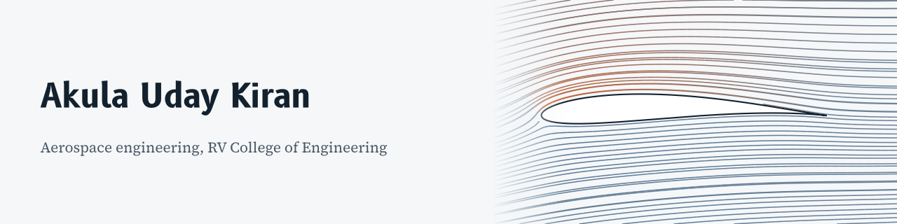

<picture>
  <source media="(prefers-color-scheme: dark)" srcset="banner-dark.png">
  
</picture>

I'm a final-year aerospace engineering student at RV College of Engineering, Bengaluru. I work on
computational fluid dynamics and numerical methods, and I trust a result only once it has survived
a check that could have proved it wrong.

**Website:** [sammyjankis19302.github.io](https://sammyjankis19302.github.io) 
**LinkedIn:** [akulaudaykiran19302](https://www.linkedin.com/in/akulaudaykiran19302/) 
**Email:** [sammyjankis19302@gmail.com](mailto:sammyjankis19302@gmail.com)

### Research

| | |
|---|---|
| [cfd-from-scratch](https://github.com/sammyjankis19302/cfd-from-scratch) | Finite-difference solvers written from the discretisation up, from linear advection to a lid-driven cavity. Research internship, CSIR–National Aerospace Laboratories, 2026 |
| [hypersonic-stagnation-heating](https://github.com/sammyjankis19302/hypersonic-stagnation-heating) | Stagnation-point heating at Mach 5 with Fay–Riddell theory, ANSYS Fluent and CFD++. Research internship, DRDO Advanced Systems Laboratory, 2025 |

### Projects

| | |
|---|---|
| [double-wedge-roughness](https://github.com/sammyjankis19302/double-wedge-roughness) | Roughness and the oblique shock on a supersonic double wedge. Gas Dynamics |
| [cubesat-docking-capture-boundary](https://github.com/sammyjankis19302/cubesat-docking-capture-boundary) | Non-linear capture boundary for electromagnetic CubeSat docking. Mathematical Modelling |
| [rcs-stealth-geometries](https://github.com/sammyjankis19302/rcs-stealth-geometries) | Radar cross section and stealth shaping, from scratch. Avionics |
| [leo-conjunction-screening](https://github.com/sammyjankis19302/leo-conjunction-screening) | Conjunction screening for a LEO digital twin. Interdisciplinary project |
| [deaerator-rotating-porous-blade](https://github.com/sammyjankis19302/deaerator-rotating-porous-blade) | A spinning porous-blade deaerator in ANSYS Fluent. Computational Fluid Dynamics |
| [variable-pitch-propeller](https://github.com/sammyjankis19302/variable-pitch-propeller) | A variable-pitch propeller on a home-built thrust bench. Aerospace Propulsion |
| [stm32-ecs-temperature-control](https://github.com/sammyjankis19302/stm32-ecs-temperature-control) | Holding a model aircraft cabin at 30 °C with an STM32. Aircraft Systems and Instrumentation |

Each repository is a full write-up: the code, the data, the figures, and an honest account of
what went wrong.
